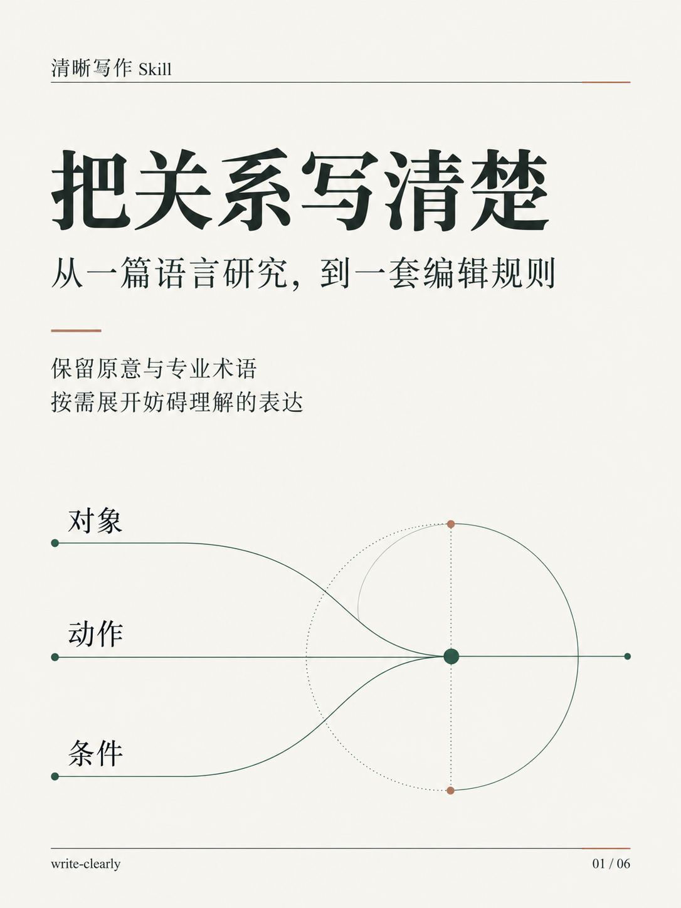
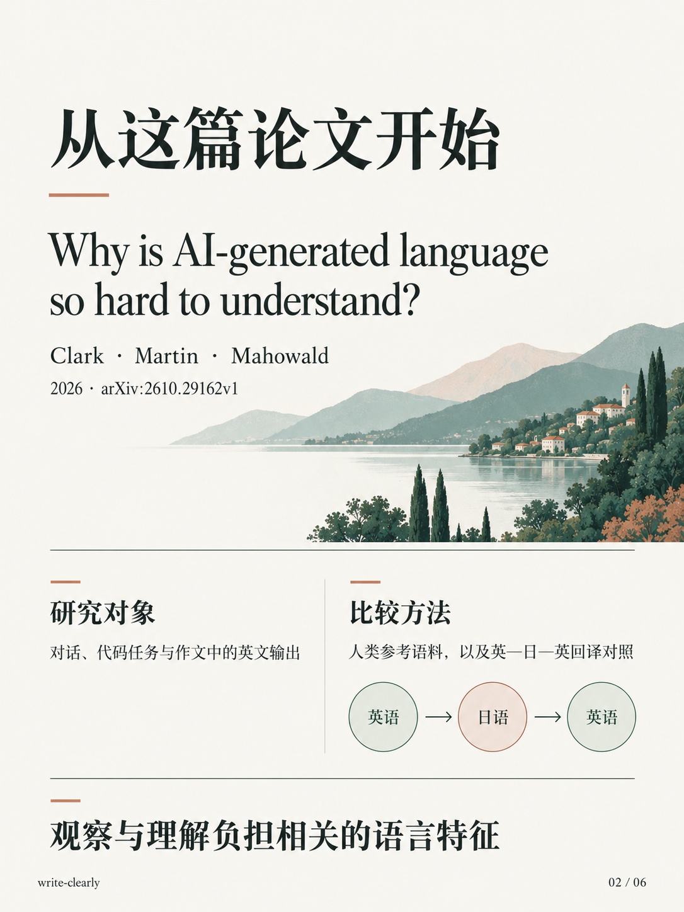
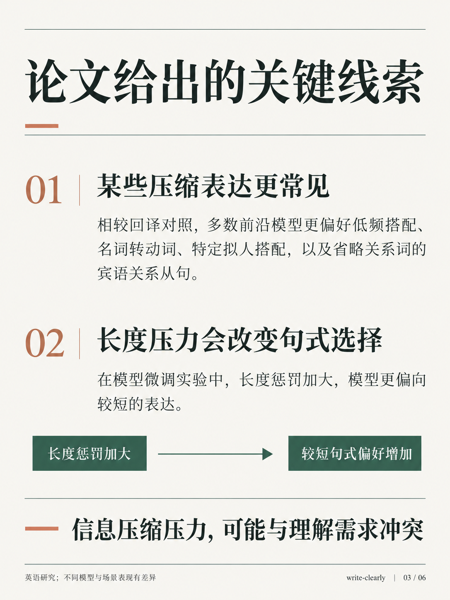
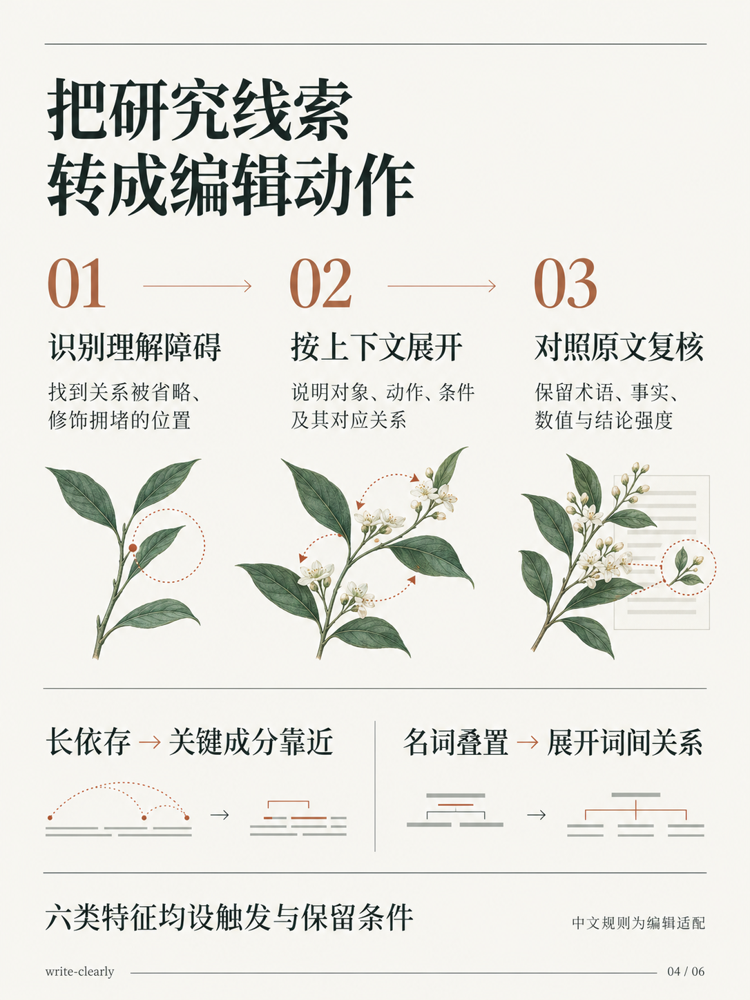
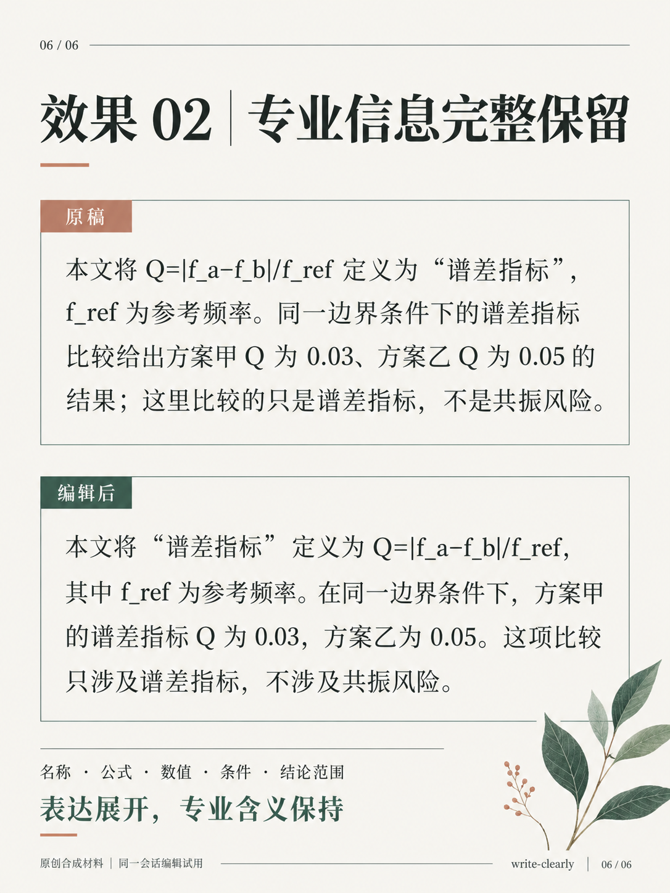

# write-clearly · 清晰写作

**保留术语，把对象、动作与关系写清楚。**

`write-clearly` 是用于起草与改写的通用写作技能，适合报告、知识解释、问题分析、建议、技术说明和学术文本。它检查妨碍理解的语言压缩，再按上下文展开必要关系，保留原意、专业名称、条件和文体。



## 从一篇论文，到这个技能

这个技能受到 Thomas Hikaru Clark、Matias B. Martin 和 Kyle Mahowald 的 2026 年预印本 [*Why is AI-generated language so hard to understand?*](https://arxiv.org/abs/2610.29162) 启发。作者研究了对话、代码任务和作文中的英文输出，比较人类参考语料，以及英—日—英回译形成的对照文本。

相较回译对照，多数前沿及接近前沿模型更偏好低频搭配、名词转成动词、特定拟人搭配，以及省略关系词的宾语关系从句。长依存和名词叠置的差异在对话、代码场景较明显，作文中的变化较小；不同模型的表现也有差异。[结果见第 3.5 节](https://arxiv.org/html/2610.29162v1#S3.SS5)。

作者还在一项模型微调实验中加入输出长度惩罚。随着惩罚加大，模型更偏向较短表达，这种偏好也迁移到部分未训练结构。这个概念验证支持了作者关于信息压缩压力的解释；商业模型偏好的具体训练成因仍需进一步研究。[实验见第 4 节](https://arxiv.org/html/2610.29162v1#S4)。

这给了本项目一个编辑方向：把读者理解所需的对象、动作、关系和条件表达出来。`write-clearly` 据此将第 3.1 节的六类特征转成有触发条件、有保留条件的编辑动作，同时保护原意、专业术语和作者定义名。

这是基于研究启发的独立实践转化。论文分析英语；中文规则按表达特点适配，技能效果以本项目的具体试用记录说明。[论文到技能的介绍稿](social/paper-to-skill.txt)。

## 看一个实际编辑对照

以下是本项目的原创合成样例，来自本会话编辑试用。

**原稿**

> 设备已到货，验收所需合格证尚未收到。因此，本周验收启动受合格证到达条件约束，仍无法开始；合格证由谁提供尚未确定。

**使用技能后的改写**

> 设备已到货，但验收所需的合格证尚未收到，因此本周验收还不能开始。合格证由谁提供尚未确定。

改写直接表达了“合格证未收到 → 验收尚不能开始”的已有关系。设备到货、缺证、验收状态和提供方未知这四项信息均保留。

再看专业文本：作者定义的“谱差指标”、公式 `Q=|f_a−f_b|/f_ref`、数值、边界条件和结论范围都应保留。技能调整的是这些信息的表达与衔接。

[完整效果展示](docs/DEMO.md) · [制作与试用记录](docs/validation.txt) · [原创正反例](skills/write-clearly/references/examples.md)

## 六类特征，按条件编辑

| 检查方向 | 有理解障碍时的动作 |
| --- | --- |
| 低频词组、不熟悉的搭配 | 依据材料补清对象、动作和关系 |
| 长依存 | 让关键成分靠近，调整插入和修饰位置 |
| 宾语关系从句 | 补关系词或展开结构，明确施受关系 |
| 名词叠置 | 保留完整术语，展开术语之间的关系 |
| 名词转成动词 | 将不明确的临时动作说具体 |
| 无生命主语与动词的拟人搭配 | 说明隐喻背后的实际含义 |

每类都写明触发条件、编辑动作、英文结构、中文适配和保留条件。已经清楚的长句、被动句、专业术语和常规用法可以保留。

各类特征的定义与适配依据，详见[来源与证据边界](skills/write-clearly/references/principles.md)。

## 使用示例

技能文件位于 `skills/write-clearly`。让所使用的 AI 助手读取技能后，提供草稿、目标读者和用途；在支持技能调用的环境中，也可以显式调用：

```text
$write-clearly
请改写以下段落。读者是有专业基础、但不了解本项目设置的同事。
保留术语、条件、数值和结论强度，只交付正文。

【粘贴草稿】
```

新写时可提供材料：

```text
$write-clearly
请依据以下要点写一段工作报告，说明当前状态和依据。
材料：……
```

## 文件与验证

```text
skills/write-clearly/
├── SKILL.md
├── agents/openai.yaml
└── references/
    ├── principles.md
    └── examples.md
```

首版已完成 skill-creator 格式校验、六个跨场景小任务、一个英文结构短检查，以及一份未附参考改写的连续两段报告试用。检查包括术语、作者定义名、条件、数值、比较基准、判断范围和承诺程度。

这些是同一会话内的编辑与保真检查，尚未进行独立对照评测或人类阅读实验；示例展示具体改动，阅读收益仍需实际使用检验。

## 竖版素材

[3:4 图文素材与发布文案](social/xiaohongshu.txt)；图片按 01—06 的顺序查看：

[封面](media/01-cover.png) · [论文介绍](media/02-paper.png) · [论文结论](media/03-findings.png) · [转成编辑规则](media/04-method.png) · [报告效果](media/05-effect-report.png) · [学术文本效果](media/06-effect-academic.png)

<p>
  
  
  
</p>
<p>
  
  
  
</p>
